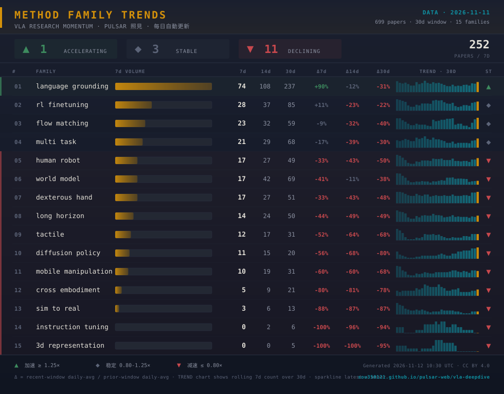

# Method Family Trends · VLA 方法族趋势

> 🖼️ **数据日期**: `2026-11-03` · **窗口**: 最近 `30` 天 · **累计论文**: `726` 篇 · **家族数**: `15`
>
> 每日自动生成 · 数据源 [pulsar-web vla-deepdive](https://sou350121.github.io/pulsar-web/vla-deepdive/)

---

## 📊 数据明细

| Family | 7d | 14d | 30d | Δ7d | Δ14d | Δ30d | Trend | Status |
|--------|:--:|:---:|:---:|:---:|:----:|:----:|:------|:------:|
| `language grounding` | 43 | 99 | 228 | 🔴 **-23%** | 🔴 **-29%** | 🔴 **-23%** | `▅▆█▆▆▇▆▆▆▅▄▄▅▄` | 🔴 ▼ |
| `world model` | 26 | 39 | 102 | 🟢 **+55%** | 🔴 **-42%** | ·  +10% | `▃▄▄▄▂▄▄▄▅▄▇▇█▆` | 🟢 ▲ |
| `rl finetuning` | 14 | 42 | 90 | 🔴 **-50%** | ·  -17% | ·  +1% | `▄▅▅▅▅▇█▇▇▆▅▅▆▃` | 🔴 ▼ |
| `long horizon` | 11 | 25 | 59 | 🔴 **-35%** | 🔴 **-32%** | ·  -15% | `▄▆▆▆▆█▆▆▆▄▅▅▆▅` | 🔴 ▼ |
| `human robot` | 11 | 25 | 55 | 🔴 **-35%** | 🔴 **-26%** | 🔴 **-21%** | `▄▆▆▆▅█▇▇█▆▆▆█▅` | 🔴 ▼ |
| `dexterous hand` | 11 | 21 | 48 | 🔴 **-35%** | 🔴 **-38%** | 🔴 **-31%** | `▇▆██▆▆▇▆▆▇▆▆█▆` | 🔴 ▼ |
| `mobile manipulation` | 11 | 16 | 37 | 🔴 **-35%** | 🔴 **-52%** | 🔴 **-47%** | `▄▄▆▅▄▄▆▆▆▆▆▆██` | 🔴 ▼ |
| `multi task` | 9 | 27 | 61 | 🔴 **-50%** | 🔴 **-26%** | ·  -12% | `▆▆█▆▅▇▆▆▅▅▃▃▄▃` | 🔴 ▼ |
| `flow matching` | 9 | 25 | 56 | 🔴 **-46%** | 🔴 **-26%** | 🔴 **-20%** | `▃▃▃▃▂▇▆▆▇▇▇▇█▃` | 🔴 ▼ |
| `cross embodiment` | 5 | 11 | 19 | 🔴 **-70%** | 🔴 **-67%** | 🔴 **-73%** | `▄▅█▇▆▆▆█▆▅▄▄▄▄` | 🔴 ▼ |
| `tactile` | 5 | 15 | 40 | 🔴 **-70%** | 🔴 **-55%** | 🔴 **-43%** | `▃▄█▇▇█▆▇▅▄▃▃▄▃` | 🔴 ▼ |
| `diffusion policy` | 5 | 7 | 16 | 🔴 **-70%** | 🔴 **-79%** | 🔴 **-77%** | `▃▅▅▅▅▅▅▆█▆▅▅██` | 🔴 ▼ |
| `sim to real` | 3 | 6 | 21 | 🔴 **-82%** | 🔴 **-82%** | 🔴 **-70%** | `▆█▆▅▃▅▅▅█▆▆▆▆▅` | 🔴 ▼ |
| `instruction tuning` | 3 | 6 | 8 | 🔴 **-82%** | 🔴 **-82%** | 🔴 **-89%** | `▂▂▆▆▆▆█▆██▄▄▆▆` | 🔴 ▼ |
| `3d representation` | 2 | 4 | 6 | 🔴 **-88%** | 🔴 **-88%** | 🔴 **-91%** | `·▂▂▂▂▄███▆▆▆▆▄` | 🔴 ▼ |

---

## 📖 图例说明

- **7d / 14d / 30d**：该家族近 7 / 14 / 30 天内出现的论文篇数
- **Δ7d / Δ14d / Δ30d**：近窗口与前一窗口每日平均的比值（>1.25 加速 / <0.80 减速）
- **Trend**：过去 14 天每天的 7 日滚动计数 sparkline
- **Status**：🟢 ▲ 加速 · · ◆ 稳定 · 🔴 ▼ 减速

## 🔗 相关资源

- 🌐 [Pulsar 照見 · VLA 深挖实时看板](https://sou350121.github.io/pulsar-web/vla-deepdive/)
- 📡 [RSS 订阅](https://sou350121.github.io/pulsar-web/subscribe/)
- 📊 [VLA 数据工程指南](../theory/foundation/vla_data_engineering_guide.md)

> 本快照由 `scripts/export-method-family-viz.py` 每日自动生成 · 最后更新 `2026-11-04 10:30 UTC` · CC BY 4.0
