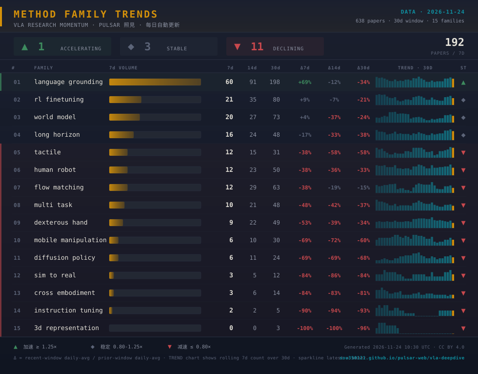

# Method Family Trends · VLA 方法族趋势

> 🖼️ **数据日期**: `2026-11-25` · **窗口**: 最近 `30` 天 · **累计论文**: `667` 篇 · **家族数**: `15`
>
> 每日自动生成 · 数据源 [pulsar-web vla-deepdive](https://sou350121.github.io/pulsar-web/vla-deepdive/)

---

## 📊 数据明细

| Family | 7d | 14d | 30d | Δ7d | Δ14d | Δ30d | Trend | Status |
|--------|:--:|:---:|:---:|:---:|:----:|:----:|:------|:------:|
| `language grounding` | 63 | 92 | 208 | 🟢 **+90%** | ·  -11% | 🔴 **-27%** | `▇▆▄▄▅▄▅▅▅▇▇█▇▇` | 🟢 ▲ |
| `rl finetuning` | 25 | 37 | 87 | ·  +20% | ·  -6% | ·  -12% | `▇▆▅▅▆▅▄▄▄▇▇█▆▇` | · ◆ |
| `long horizon` | 19 | 27 | 53 | ·  -9% | 🔴 **-31%** | 🔴 **-35%** | `▅▅▄▄▅▄▅▅▅▇▇█▆█` | · ◆ |
| `world model` | 19 | 26 | 74 | ·  -9% | 🔴 **-41%** | 🔴 **-20%** | `▅▄▃▃▄▃▄▄▄▇▇█▆▆` | · ◆ |
| `tactile` | 14 | 15 | 33 | 🔴 **-33%** | 🔴 **-62%** | 🔴 **-59%** | `▇▆▄▄▅▂▃▅▅▅▆▇▇█` | 🔴 ▼ |
| `human robot` | 13 | 22 | 52 | 🔴 **-38%** | 🔴 **-44%** | 🔴 **-36%** | `▇▆▅▅▇▅▅▆▆▆▆█▅▆` | 🔴 ▼ |
| `multi task` | 11 | 19 | 50 | 🔴 **-47%** | 🔴 **-52%** | 🔴 **-38%** | `█▆▆▆▇▅▄▄▄▅▅▆▄▅` | 🔴 ▼ |
| `flow matching` | 11 | 21 | 63 | 🔴 **-47%** | 🔴 **-46%** | 🔴 **-22%** | `▆▆▆▆█▅▃▃▃▅▅▅▄▃` | 🔴 ▼ |
| `dexterous hand` | 9 | 20 | 49 | 🔴 **-57%** | 🔴 **-49%** | 🔴 **-39%** | `▇▇▆▆█▆▅▆▅▅▅▅▄▄` | 🔴 ▼ |
| `mobile manipulation` | 7 | 9 | 31 | 🔴 **-67%** | 🔴 **-77%** | 🔴 **-62%** | `█▇▅▅▇▃▃▃▃▅▅▆▅▅` | 🔴 ▼ |
| `diffusion policy` | 5 | 9 | 24 | 🔴 **-76%** | 🔴 **-77%** | 🔴 **-70%** | `█▇▅▅▇▆▄▅▅▇▇█▆▅` | 🔴 ▼ |
| `cross embodiment` | 5 | 7 | 16 | 🔴 **-76%** | 🔴 **-82%** | 🔴 **-80%** | `▅▅▆▆▆▅▅▅▅▅▃▅▅█` | 🔴 ▼ |
| `sim to real` | 4 | 6 | 13 | 🔴 **-81%** | 🔴 **-85%** | 🔴 **-84%** | `▅▅▃▃▆▃▃▃▃▆▆█▅▆` | 🔴 ▼ |
| `instruction tuning` | 3 | 3 | 6 | 🔴 **-86%** | 🔴 **-92%** | 🔴 **-93%** | `·······▅▅▅▅▅▅█` | 🔴 ▼ |
| `3d representation` | 1 | 1 | 4 | 🔴 **-95%** | 🔴 **-97%** | 🔴 **-95%** | `·············█` | 🔴 ▼ |

---

## 📖 图例说明

- **7d / 14d / 30d**：该家族近 7 / 14 / 30 天内出现的论文篇数
- **Δ7d / Δ14d / Δ30d**：近窗口与前一窗口每日平均的比值（>1.25 加速 / <0.80 减速）
- **Trend**：过去 14 天每天的 7 日滚动计数 sparkline
- **Status**：🟢 ▲ 加速 · · ◆ 稳定 · 🔴 ▼ 减速

## 🔗 相关资源

- 🌐 [Pulsar 照見 · VLA 深挖实时看板](https://sou350121.github.io/pulsar-web/vla-deepdive/)
- 📡 [RSS 订阅](https://sou350121.github.io/pulsar-web/subscribe/)
- 📊 [VLA 数据工程指南](../theory/foundation/vla_data_engineering_guide.md)

> 本快照由 `scripts/export-method-family-viz.py` 每日自动生成 · 最后更新 `2026-11-25 10:30 UTC` · CC BY 4.0
