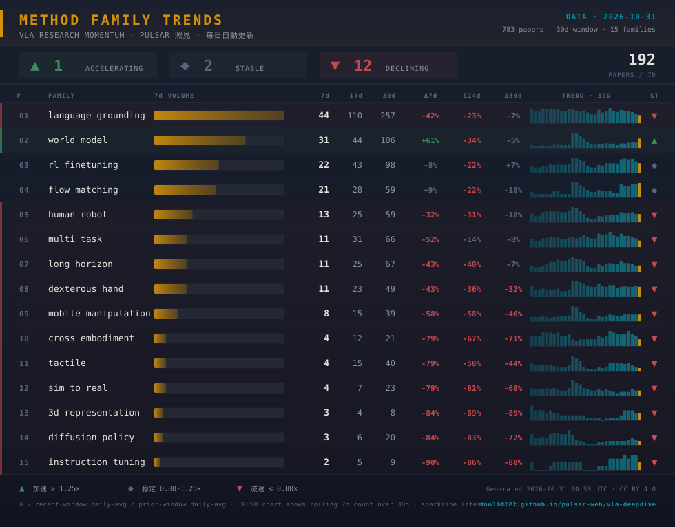

# Method Family Trends · VLA 方法族趋势

> 🖼️ **数据日期**: `2026-10-31` · **窗口**: 最近 `30` 天 · **累计论文**: `783` 篇 · **家族数**: `15`
>
> 每日自动生成 · 数据源 [pulsar-web vla-deepdive](https://sou350121.github.io/pulsar-web/vla-deepdive/)

---

## 📊 数据明细

| Family | 7d | 14d | 30d | Δ7d | Δ14d | Δ30d | Trend | Status |
|--------|:--:|:---:|:---:|:---:|:----:|:----:|:------|:------:|
| `language grounding` | 44 | 110 | 257 | 🔴 **-42%** | 🔴 **-23%** | ·  -7% | `▅▅▇▅▆█▆▆▇▆▆▆▅▄` | 🔴 ▼ |
| `world model` | 31 | 44 | 106 | 🟢 **+61%** | 🔴 **-34%** | ·  -5% | `▃▃▄▃▄▄▄▃▄▄▄▅▅█` | 🟢 ▲ |
| `rl finetuning` | 22 | 43 | 98 | ·  -8% | 🔴 **-22%** | ·  +7% | `▃▃▄▄▅▅▅▅▇█▇▇▆▅` | · ◆ |
| `flow matching` | 21 | 28 | 59 | ·  +9% | 🔴 **-22%** | ·  -18% | `▃▃▄▄▄▄▃▃▇▆▆▇▇█` | · ◆ |
| `human robot` | 13 | 25 | 59 | 🔴 **-32%** | 🔴 **-31%** | ·  -18% | `▃▃▅▄▆▆▆▅█▇▇█▆▆` | 🔴 ▼ |
| `multi task` | 11 | 31 | 66 | 🔴 **-52%** | ·  -14% | ·  -8% | `▅▅▇▆▆█▆▅▇▆▆▅▅▃` | 🔴 ▼ |
| `long horizon` | 11 | 25 | 67 | 🔴 **-43%** | 🔴 **-40%** | ·  -7% | `▃▃▆▄▆▆▆▆█▆▆▆▄▅` | 🔴 ▼ |
| `dexterous hand` | 11 | 23 | 49 | 🔴 **-43%** | 🔴 **-36%** | 🔴 **-32%** | `▆▆█▇▆▇▇▆▆▇▆▆▇▆` | 🔴 ▼ |
| `mobile manipulation` | 8 | 15 | 39 | 🔴 **-58%** | 🔴 **-58%** | 🔴 **-46%** | `▃▃▆▅▆█▇▆▆█████` | 🔴 ▼ |
| `cross embodiment` | 4 | 12 | 21 | 🔴 **-79%** | 🔴 **-67%** | 🔴 **-71%** | `▄▄▅▄▅█▇▆▆▆█▆▅▄` | 🔴 ▼ |
| `tactile` | 4 | 15 | 40 | 🔴 **-79%** | 🔴 **-58%** | 🔴 **-44%** | `▂▂▃▃▄█▇▇█▆▇▅▄▃` | 🔴 ▼ |
| `sim to real` | 4 | 7 | 23 | 🔴 **-79%** | 🔴 **-81%** | 🔴 **-68%** | `▆▆█▆█▆▅▃▅▅▅█▆▆` | 🔴 ▼ |
| `3d representation` | 3 | 4 | 8 | 🔴 **-84%** | 🔴 **-89%** | 🔴 **-89%** | `▂▂▂·▂▂▂▂▄███▆▆` | 🔴 ▼ |
| `diffusion policy` | 3 | 6 | 20 | 🔴 **-84%** | 🔴 **-83%** | 🔴 **-72%** | `▂▂▃▃▅▅▅▅▅▅▆█▆▅` | 🔴 ▼ |
| `instruction tuning` | 2 | 5 | 9 | 🔴 **-90%** | 🔴 **-86%** | 🔴 **-88%** | `··▂▂▂▆▆▆▆█▆██▄` | 🔴 ▼ |

---

## 📖 图例说明

- **7d / 14d / 30d**：该家族近 7 / 14 / 30 天内出现的论文篇数
- **Δ7d / Δ14d / Δ30d**：近窗口与前一窗口每日平均的比值（>1.25 加速 / <0.80 减速）
- **Trend**：过去 14 天每天的 7 日滚动计数 sparkline
- **Status**：🟢 ▲ 加速 · · ◆ 稳定 · 🔴 ▼ 减速

## 🔗 相关资源

- 🌐 [Pulsar 照見 · VLA 深挖实时看板](https://sou350121.github.io/pulsar-web/vla-deepdive/)
- 📡 [RSS 订阅](https://sou350121.github.io/pulsar-web/subscribe/)
- 📊 [VLA 数据工程指南](../theory/foundation/vla_data_engineering_guide.md)

> 本快照由 `scripts/export-method-family-viz.py` 每日自动生成 · 最后更新 `2026-10-31 10:30 UTC` · CC BY 4.0
