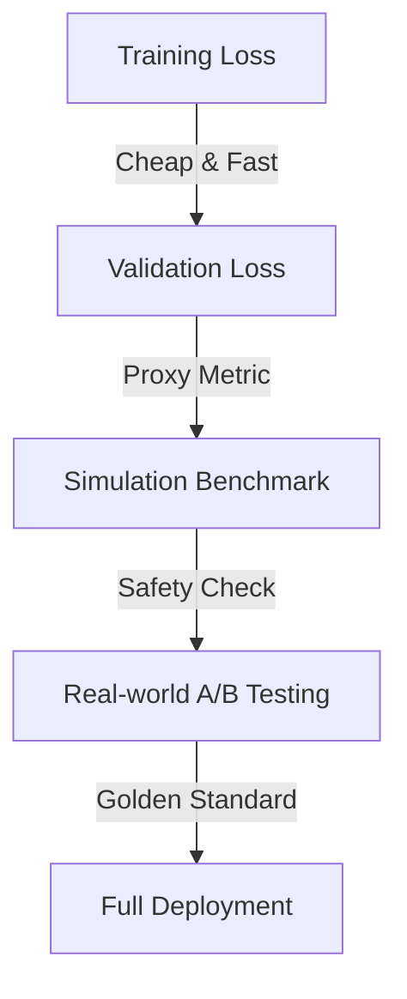

# VLA 评估系统设计 (Evaluation System Design)

> **面试场景**: "模型训练好了，怎么知道它是不是变强了？如何决定是否推送到 100 台机器人上？"

评估 (Evaluation) 是 VLA 数据飞轮中最关键的 "过滤器"。错误的评估会导致 "坏模型" 上线，造成物理损坏。

## 1. 评估的分层架构 (The Evaluation Pyramid)

评估应该是一个漏斗，从便宜到昂贵，从仿真到真机。

### 1.1 Level 0: Training/Validation Loss
- **指标**: Action Prediction Loss (MSE or Cross-Entropy).
- **局限**: **Goodhart's Law**。Loss 降低 $\neq$ 成功率提高。
    - *例子*: 机器人在离目标 1cm 处停下 (Loss 很小)，但没抓到物体 (任务失败)。
- **作用**: 快速过滤掉明显训练失败的模型 (Sanity Check)。

### 1.2 Level 1: Simulation Benchmark (仿真基准)
- **工具**: Isaac Sim, ManiSkill, RLBench.
- **方法**:
    - 在仿真中构建 100+ 个测试场景 (不同的物体位置、光照、桌子高度)。
    - 运行模型 1000 次，计算 **Success Rate (SR)**。
- **挑战**: **Sim-to-Real Gap**。仿真里表现好，真机不一定好。
- **对策**: 
    - 使用 **System Identification** 调整仿真参数。
    - 同时记录相对提升与绝对分数；未在目标任务上验证仿真—真机对应关系前，不能从仿真中的相对排名直接推断真机排名。额外检查下文的[失败恢复能力](#failure-recovery-evaluation)。

### 1.3 Level 2: Real-world Proxy (真机代理指标)
- **方法**: 使用预留的 **Golden Validation Set** (高质量真机数据)。
- **Open-Loop Evaluation**: 
    - 给定一段视频的前 $T$ 帧，预测第 $T+1$ 帧的动作。
    - 计算预测动作与真实动作的距离。
- **局限**: 无法评估 **累积误差** (Compounding Error)。

### 1.4 Level 3: Real-world A/B Testing (真机灰度测试)
- **Canary Deployment (金丝雀发布)**:
    - 先推送到 5% 的机器人 (通常是实验室里的测试机)。
    - 运行标准测试任务 (e.g., "连续抓取 50 次")。
- **Shadow Mode (影子模式)**:
    - 在后台运行新模型，但不执行动作。
    - 记录新模型的输出，与当前运行的老模型 (或人类操作) 进行对比。
    - 如果新模型的动作与老模型差异过大 (Anomaly Detection)，则报警。

## 2. 核心指标 (Key Metrics)

除了成功率，还需要关注什么？

| 指标 | 说明 | 重要性 |
| :--- | :--- | :--- |
| **Success Rate (SR)** | 任务完成率 | ⭐⭐⭐⭐⭐ (北极星指标) |
| **Execution Time** | 完成任务所需时间 | ⭐⭐⭐ (效率) |
| **Smoothness (Jerk)** | 动作的平滑度 (加速度的导数) | ⭐⭐⭐⭐ (保护电机，减少磨损) |
| **Safety Rate** | 急停 (E-Stop) 触发频率 | ⭐⭐⭐⭐⭐ (安全底线) |
| **Intervention Rate** | 人类接管频率 (MPI: Miles Per Intervention) | ⭐⭐⭐⭐ (自动驾驶常用) |

## 3. 自动化评估基础设施 (Infrastructure)

### 3.1 Evaluator Service
- 一个独立的微服务，监听 Model Registry。
- 当有新模型 Checkpoint 产生时，自动触发：
    1.  拉取权重。
    2.  启动 Kubernetes Job 运行 Isaac Sim 评估。
    3.  将结果写入 Metadata Store (MLflow/W&B)。
    4.  如果 SR > Threshold，标记为 `candidate-release`。

### 3.2 Visualization
- **W&B Dashboard**: 绘制 Loss 曲线和 Sim SR 曲线。
- **Video Gallery**: 自动保存仿真中失败的案例视频，供人工分析。

## 4. 面试 Q&A

**Q: 为什么 Loss 降了，成功率反而降了？**
A: 这通常是因为 **Distribution Shift** 或 **Overfitting**。
- 模型可能过拟合了训练数据的特定轨迹，导致在稍微不同的初始状态下无法纠偏 (Drift)。
- 解决方法：增加数据增强 (Data Augmentation)，引入噪声，或使用 DAgger (Dataset Aggregation) 收集纠偏数据。

**Q: 如何评估长序列任务 (Long-horizon Tasks)？**
A: 
- **Sub-goal Evaluation**: 将长任务拆解为子目标 (e.g., 打开柜子 -> 拿起杯子 -> 关上柜子)。分别评估每个子目标的成功率。
- **Success weighted by Path Length (SPL)**: 不仅看是否成功，还看路径是否高效。

## 5. 失败恢复评测：先固定问题、状态集与分母

> **2026-11-08 工程建议**：补充§2的常规成功率与介入指标，不另建排行榜。本节不是LIBERO-Recover／WorldFailBench的官方协议，也不是本仓库已经运行的评测服务。上文的次数、机队比例等均为设计示例，不能直接当所有任务的门槛。

### 5.1 两类试验不能混成一个恢复分数

| 试验 | 要回答的问题 | 分母与比较边界 |
|---|---|---|
| 自然执行失败，再给恢复机会 | 策略从正常初态开始，包含自己的错误后，整项任务能否完成？ | 以全部预定任务启动数报告首次完成与允许恢复后的完成；不同策略产生的失败难度不同，条件恢复率不能直接当公平排名 |
| 固定失败状态面板 | 多个候选策略面对同一组偏离态，哪个能在约定预算内恢复？ | 先冻结状态／场景、任务阶段、来源与数量，所有候选使用同一面板；这不是从正常初态运行的总体成功率 |

仿真保存恢复所需的完整状态和随机种子，避免只存RGB就声称同初态。真机无法精确复位时，保存布置、姿态等测量和允许偏差，使用匹配条件与平衡顺序比较，并报告未能复位的次数；不宣称逐条状态完全一致。外部构造的偏离态与模型自身失败分别标注。

面板与训练／恢复示教按原始session、物体和场景分组隔离，不能看了测试失败再补训后仍称同一留出测试。候选发生实质改变时保留版本并报告新一轮结果。划分方法复用[数采验收§5](../deployment/robot_data_collection_acceptance.md#5-划分数据时避免看起来泛化)。

### 5.2 测试前填好状态、预算和判据

每个测试项至少记录 `case_id`、来源episode／状态快照、任务与阶段、固定的可恢复性规则、环境／本体、相机和控制版本、成功判据、失败判据、最长时间／重试数、人工介入与复位规则。可恢复性由任务定义和执行前可检查条件决定，不能根据某个模型是否成功事后改标签。

以下是**本文的场景划分示例，不是论文原有等级**；只在已批准的实验条件内构造，不为凑类型制造不可控接触。

| 场景 | 分别观察什么 | 不能混淆的结果 |
|---|---|---|
| 抓空／夹爪闭合但无物体 | 是否识别未抓住、是否重新接近、是否最终完成放置 | 继续空手放置不算恢复；人工塞入物体不算自主成功 |
| 搬运中滑落 | 是否检测事件、重建阶段并重抓 | 看见物体仍在画面里不代表知道任务阶段 |
| 目标位置变化／取错目标 | 是否根据指令与新观测纠偏 | 增加物体、换背景和改指令应拆开，不能同时改后定因 |
| 必须先复原局部状态 | 是否先清理／退回必要状态，再完成原任务 | 人工复位后做成，应记介入完成，而非本次自主恢复 |

失败参考时刻由仿真事件、独立传感判据或事后标注产生，保存判据版本与不确定区间；模型的“我失败了”不能同时充当自身检测正确的真值。参考标签用于评分，不额外泄露给策略；若策略接收外部失败信号，应对所有候选一致并单列为外部触发设置。

### 5.3 指标要保留分子、分母和未完成项

| 指标 | 建议口径 | 必须同时报告 |
|---|---|---|
| 首次任务成功率 | 首个参考失败发生前完成的次数／全部预定任务启动数 | 自然执行试验的任务与初态分布；不能靠模型是否自报进入恢复来划界 |
| 允许恢复后的总体完成率 | 固定总预算内，无人工接管完成的次数／同一批任务启动数 | 与首次成功使用同一分母；介入完成另列 |
| 固定面板自主恢复率 | 在预先约定可恢复状态中，无人工接管且按预算完成原任务的次数／全部该类面板尝试数 | 超时、人工接管和安全停止仍保留在分母；不能仅对检测到的失败计算主指标 |
| 失败检测率 | 在预定窗口内检出的参考失败事件数／全部参考失败事件数 | 窗口、重复报警合并规则、检测时延；同时列非失败窗口的误报数／窗口数 |
| 恢复耗时与代价 | 从参考失败时刻到最终完成；不是只从报警后计时 | 成功样本数、成功耗时分布、每次重试和未完成数量；超时不填0，也不只报成功者平均值就声称更快 |
| 介入与停止 | 人工接管、安全停止的次数及原因／全部尝试数 | 一次尝试可有多个事件；事件数与最终结果类别分别记，不能加出伪造的成功数 |

未启动、日志丢失、初始化失败均单列。若缺失使结果无法判定，结果为“未完成验收”，不得静默删除后给出通过结论；如另报可评分子集，须同时给全量分母、缺失原因和敏感性口径。预先声明不可恢复的状态也要报告数量和理由，另评估正确停止／求助行为，不能临时从失败中剔除。

没有参考失败事件、没有非失败窗口或没有有效尝试时，对应比率记为“不适用／无样本”，不填0%或100%。失败时刻无法可靠判定时，不补猜检测／恢复时延；保留该项待验及原因。

**纯假设算例，不是这30篇的实测：** 固定面板有12次预定可恢复尝试；最终类别互斥地分为自主完成6、人工接管完成2、超时2、安全停止2。主恢复率为 `6/12 = 50%`，不是把后6次去掉后写成100%。若9次在窗口内检出失败，检测率是 `9/12 = 75%`；检测到不等于恢复成功。正确停止可另有价值，但仍不能算任务完成。

### 5.4 发布结果时怎样保留证据边界

报告面板构造、独立来源数、重复次数、各任务分子／分母、预算、版本、介入与缺失。保留单次状态、观测、动作和阶段时间线，使“抓错物体”与“抓住后掉落”不会只剩同一个failure标签。阈值在测试前按任务确定；小样本点估计不宣称稳定排名或统计显著。加入恢复数据后的模型还要复测原正常任务，检查是否牺牲原能力。

| 参考来源 | 证据层级 | 本节采用什么、未采用什么 |
|---|---|---|
| [Leo：LIBERO恢复评测解读](https://www.xiaohongshu.com/explore/6aa0f192000000000e03f400) | 二手论文解读，原表格与分母尚未独立核对 | 采用“从失败状态重新评测”的问题意识，不引用标题中的跌幅作已核结果 |
| [WorldFailBench社区解读](https://www.xiaohongshu.com/explore/6ae18a010000000023010a25) | 二手解读，未核原论文／七模型实验 | 采用原因、阶段与触发边界要分开的诊断问题，不声称本节复刻官方基准 |
| [Whynot：GR00T空手放置](https://www.xiaohongshu.com/explore/6a278d680000000022021f8c) | 作者带配置的失败自述，无完整成功分母 | 用于设计抓空后是否仍走原流程的测试，不据此裁定模型机制或恢复训练必有效 |

原帖阅读范围与反方见[30篇社群档案](../memory/blog/archives/xiaohongshu-community/2026-11-08-codex-weekly.md)；数采质量不等于任务成败，按[验收记录](../deployment/robot_data_collection_acceptance.md#collection-acceptance-record)区分。发现时序或控制异常时先走[真机排查流程](../cheat-sheet/failure-modes.md#real-world-diagnosis)，不要把工程故障直接计为已证实的学习机制结论。

---
[← Back to System Design](./README.md)
